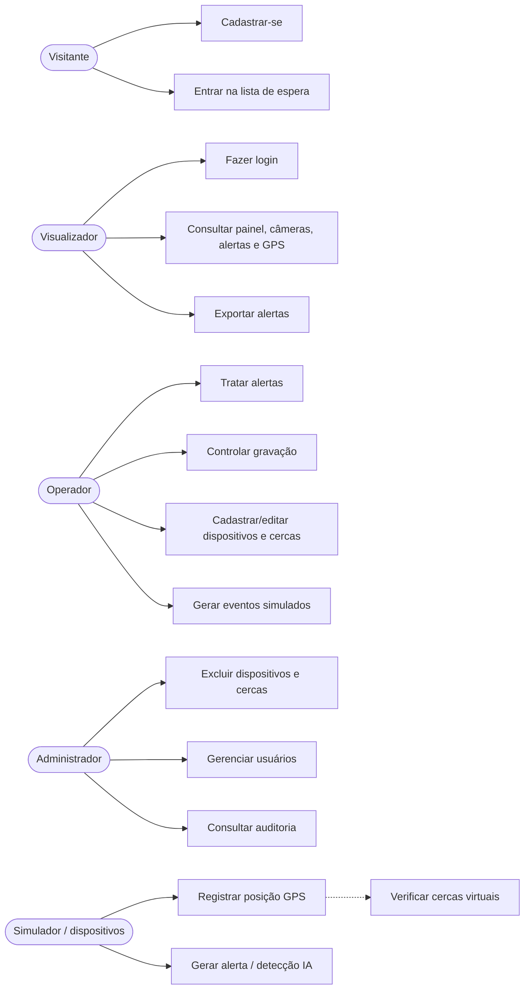
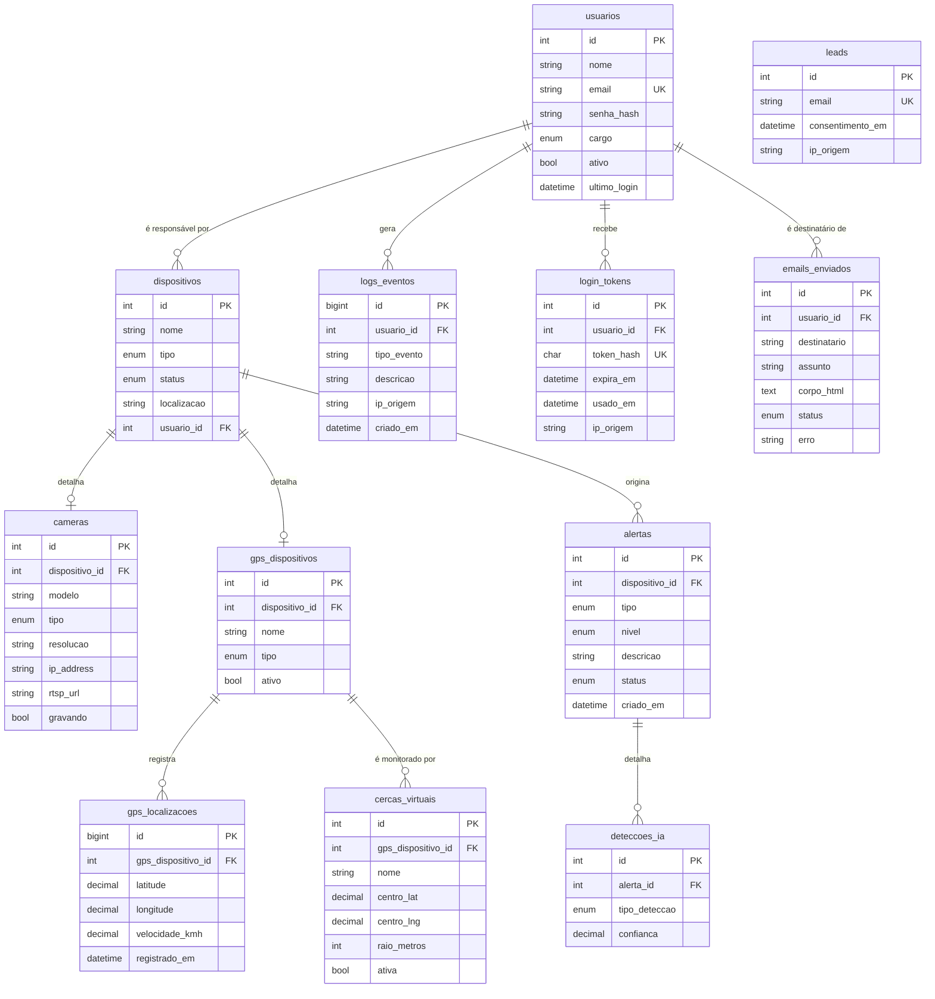
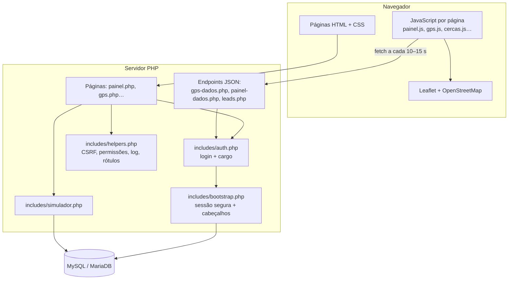
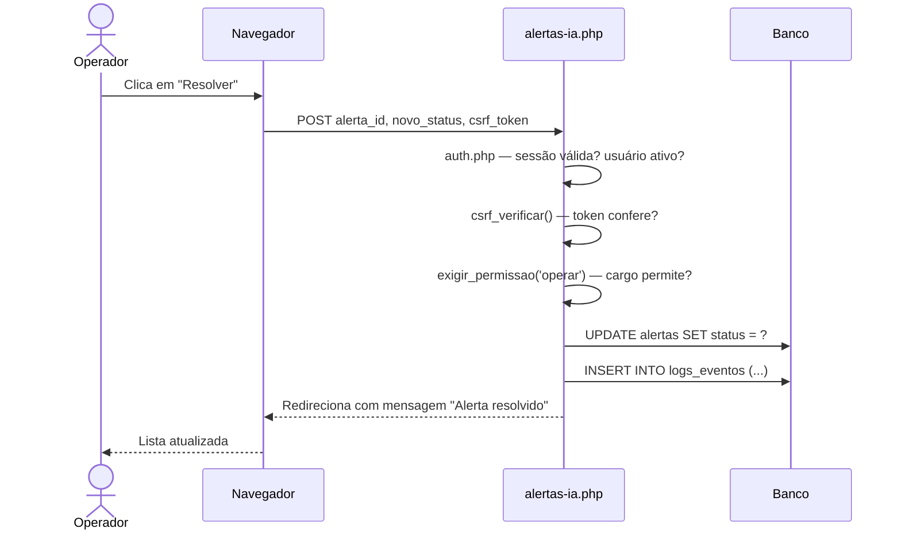
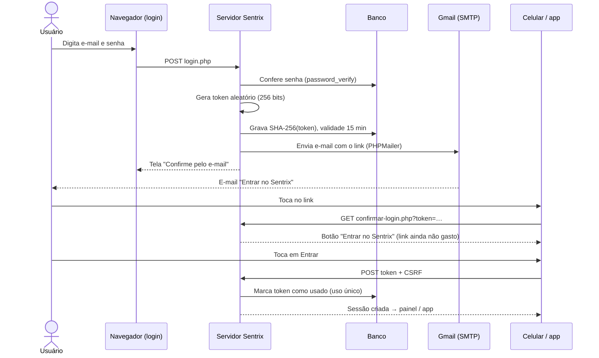

# Documentação técnica — Sentrix Guard Flow

Material de apoio para a monografia. Os diagramas estão em **Mermaid**: o GitHub
os mostra automaticamente, e para gerar imagens basta colar o código em
<https://mermaid.live> e exportar em PNG/SVG.

---

## 1. Objetivo

Oferecer uma plataforma web única para acompanhar a segurança de um local
(residência ou empresa): estado de câmeras e sensores, rastreamento de veículos
e pessoas por GPS, cercas virtuais e alertas classificados por inteligência
artificial, com controle de acesso por cargo e rastreabilidade das ações.

## 2. Requisitos funcionais

| ID | Requisito | Cargo |
|---|---|---|
| RF01 | O sistema deve permitir o cadastro público de usuários, que começam com cargo *visualizador*. | Público |
| RF02 | O sistema deve autenticar usuários por e-mail e senha. | Todos |
| RF03 | O sistema deve exibir um painel com indicadores atualizados automaticamente. | Todos |
| RF04 | O sistema deve permitir cadastrar, editar e consultar dispositivos (câmera, sensor, GPS, alarme). | Admin, Operador |
| RF05 | O sistema deve permitir excluir dispositivos. | Admin |
| RF06 | O sistema deve permitir iniciar e parar a gravação de câmeras online. | Admin, Operador |
| RF07 | O sistema deve listar alertas com filtros por status e nível. | Todos |
| RF08 | O sistema deve permitir marcar alertas como visualizados, resolvidos ou reabri-los. | Admin, Operador |
| RF09 | O sistema deve exportar alertas em CSV. | Todos |
| RF10 | O sistema deve registrar detecções de IA com tipo e grau de confiança. | Sistema |
| RF11 | O sistema deve exibir a posição atual e a trilha recente dos rastreadores em um mapa atualizado automaticamente. | Todos |
| RF12 | O sistema deve permitir criar, ativar/desativar e excluir cercas virtuais. | Admin, Operador (excluir: Admin) |
| RF13 | O sistema deve gerar alerta automático quando um rastreador sair de uma cerca virtual ativa. | Sistema |
| RF14 | O sistema deve permitir ao administrador alterar cargo, ativar/desativar e redefinir senha de usuários. | Admin |
| RF15 | O sistema deve registrar em log de auditoria logins, falhas de login e ações relevantes. | Sistema |
| RF16 | O sistema deve permitir consultar o log de auditoria com filtros. | Admin |
| RF17 | O sistema deve capturar e-mails para a lista de espera do aplicativo, com consentimento. | Público |
| RF18 | O sistema deve oferecer um simulador de eventos para demonstração. | Admin, Operador |
| RF19 | Após a senha correta, o sistema deve enviar ao e-mail do usuário um link de acesso de uso único, válido por 15 minutos, e só liberar o acesso quando o link for confirmado. | Todos |
| RF20 | O sistema deve permitir reenviar o link (com intervalo mínimo de 60 s e no máximo 5 envios por login). | Todos |
| RF21 | O sistema deve permitir ao administrador configurar a conta de envio (Gmail/SMTP), enviar um e-mail de teste e consultar o histórico de envios. | Admin |
| RF22 | O sistema deve poder ser instalado como aplicativo (PWA) no celular e no computador, e mostrar uma tela própria quando estiver sem conexão. | Todos |

## 3. Requisitos não funcionais

| ID | Requisito |
|---|---|
| RNF01 | **Segurança:** senhas com hash bcrypt; consultas preparadas; proteção contra XSS e CSRF; limite de tentativas de login; permissões verificadas no servidor. |
| RNF02 | **Privacidade:** coleta mínima de dados, consentimento explícito e política de privacidade conforme a LGPD (Lei 13.709/2018). |
| RNF03 | **Usabilidade:** interface responsiva (computador e celular), mensagens de retorno após cada ação. |
| RNF04 | **Acessibilidade:** navegação por teclado, link "pular para o conteúdo", foco preso no modal, respeito à preferência de reduzir animações. |
| RNF05 | **Desempenho:** índices nas consultas mais frequentes; atualizações automáticas pausam quando a aba não está visível. |
| RNF06 | **Portabilidade:** roda em qualquer servidor com PHP 8 e MySQL/MariaDB, sem dependências externas além do Leaflet. |
| RNF07 | **Rastreabilidade:** toda ação de alteração fica registrada com usuário, data/hora e IP. |
| RNF08 | **Manutenibilidade:** configuração centralizada, funções reutilizáveis e testes automatizados. |
| RNF09 | **Autenticação em dois fatores:** algo que a pessoa sabe (senha) + algo que ela tem (acesso à caixa de e-mail). |
| RNF10 | **Disponibilidade da demonstração:** sem SMTP configurado ou sem internet, o fluxo de login continua demonstrável pela caixa de saída local. |

## 4. Atores e casos de uso

Cada cargo herda os casos de uso do cargo abaixo (Administrador ⊃ Operador ⊃ Visualizador).

## 5. Modelo de dados

Decisões de modelagem:

- **Especialização** (`dispositivos` → `cameras` / `gps_dispositivos`): dados comuns
  ficam em `dispositivos`; dados específicos ficam nas tabelas filhas (1:0..1).
- **Exclusão:** ao excluir um dispositivo, câmeras e rastreadores são apagados
  em cascata, mas os **alertas permanecem** no histórico (`ON DELETE SET NULL`).
- `cercas_virtuais.gps_dispositivo_id = NULL` significa que a cerca vale para
  **todos** os rastreadores.
- Índices em `alertas(status, nivel)`, `alertas(criado_em)`,
  `gps_localizacoes(gps_dispositivo_id, registrado_em)` e
  `logs_eventos(tipo_evento, ip_origem, criado_em)` aceleram as telas e o
  controle de tentativas de login.

## 6. Arquitetura

Aplicação PHP em camadas simples, sem framework:

### Fluxo de uma ação protegida (ex.: resolver alerta)

### Algoritmo de cerca virtual

A cada nova posição de um rastreador, o sistema calcula a distância até o
centro de cada cerca ativa usando a **fórmula de Haversine**
(`distancia_metros()` em `includes/helpers.php`). Se a posição anterior estava
**dentro** do raio e a nova está **fora**, é criado um alerta
*Saída de cerca virtual*. Comparar com a posição anterior evita repetir o
alerta enquanto o rastreador continua fora.

### Login com link por e-mail

Por que o link só é gasto no POST: serviços como Gmail e Outlook "visitam" os
links dos e-mails para checar vírus. Se o acesso fosse liberado já na visita
(GET), esse robô gastaria o link antes da pessoa.

### Aplicativo (PWA)

| Peça | Arquivo | Função |
|---|---|---|
| Manifest | `manifest.webmanifest` | Nome, ícones, cor e página inicial do app (`painel.php`) |
| Service worker | `sw.js` | Guarda CSS/JS/ícones; páginas e dados sempre vêm do servidor; sem conexão, mostra `offline.html` |
| Instalação | `assets/js/main.js` | Mostra o botão "Instalar" quando o navegador permite (`beforeinstallprompt`) |

O navegador só permite instalar PWAs em **https://** ou em `localhost`. Por
isso, no computador que roda o sistema a instalação funciona direto; no celular,
o site precisa estar publicado com HTTPS.

## 7. Limitações e trabalhos futuros

| Limitação atual | Evolução proposta |
|---|---|
| Detecções de IA geradas pelo simulador | Integrar um modelo de detecção de objetos (ex.: YOLO) processando o stream RTSP e gravando em `deteccoes_ia` |
| Sem vídeo ao vivo no navegador | Converter RTSP para HLS/WebRTC (ex.: MediaMTX) e exibir no card da câmera |
| Posições GPS simuladas | Endpoint autenticado por token para rastreadores físicos enviarem posições |
| Atualização por consulta periódica (polling) | WebSockets ou Server-Sent Events |
| Notificações só por e-mail (login) | Alertas por push (Web Push, aproveitando o service worker do PWA) e SMS |
| Sem recuperação de senha por e-mail | Fluxo "esqueci minha senha" com token de uso único |
| Segundo fator só por e-mail | Opção de TOTP (Google Authenticator) ou chaves de acesso (passkeys) |
| App instalável no celular depende de HTTPS | Publicar em hospedagem com certificado (ex.: Let's Encrypt) |
